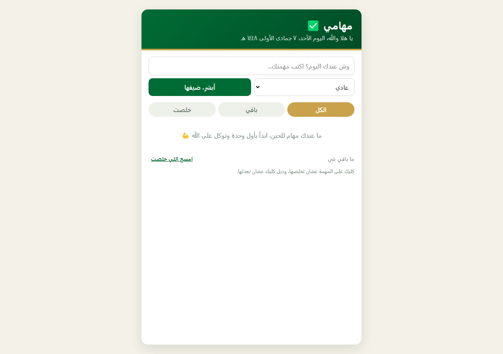

# مهامي ✅

قايمة مهام بسيطة وسريعة، بواجهة عربية RTL ولهجة سعودية خالصة. تطبيق صغير بس مبني بعناية: كل سطر كود مكتوب يدوي بدون أي مكتبة أو فريمورك أو أدوات بناء (build tools) — افتح الملف وشغّل، وخلاص.



## وش فيه

- إضافة مهمة بسرعة، مع أولوية (عادي / مرة مهم 🔥 / على مهلك).
- تبويبات فلترة: الكل، باقي، خلصت.
- كليك على المهمة عشان تعلّمها خلصت، ودبل كليك عشان تعدلها.
- مسح كل المهام الخلصانة بزر واحد.
- عداد يبين كم باقي وكم خلص، مع رسالة تحفيزية لما تخلص كل شي.
- كل البيانات تتخزن في متصفحك (`localStorage`) — ولا توصل لأي سيرفر.

## التشغيل

افتح `index.html` في أي متصفح، أو شغّل سيرفر محلي بسيط:

```bash
npx serve .
# أو
python3 -m http.server 8000
```

## التقنيات

HTML + CSS + JavaScript خالص (Vanilla JS). البيانات في طبقة منفصلة (`js/todo.js`) عن منطق الواجهة (`js/script.js`)، عشان الكود يضل مرتب وسهل تقرأه.

## الفكرة والمصدر

الفكرة العامة لقايمة المهام (Todo App) مستوحاة من مشاريع مفتوحة المصدر برخصة MIT على GitHub. الكود هنا مكتوب من جديد بالكامل.
